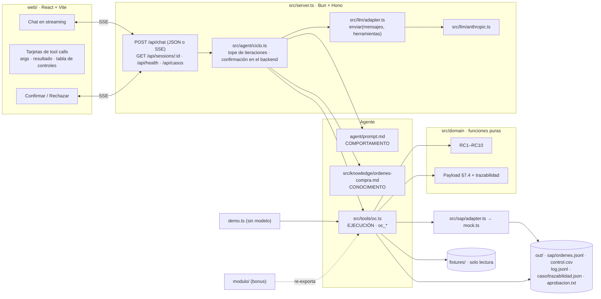
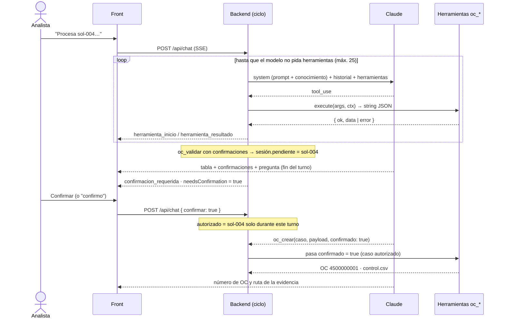

# SOLUCIÓN — Reto 03 · Agente conversacional "Órdenes de Compra SAP"

> Repositorio · `demo.ts` · URL pública: ver [README](README.md). Especificación previa al código: [`spec/reglas.md`](spec/reglas.md).

## 1. Problema en una frase

La analista administrativa digita a mano en SAP cada orden de compra y valida de memoria si el aprobador puede aprobar ese monto en ese centro: es lento, propenso a errores contables y nadie mide cuántas OC se crean **después** de la factura. Le duele a la analista (tiempo), a contabilidad y auditoría (errores y control) y a la dirección (no puede medir el desvío).

## 2. Arquitectura



**Separación que pide el PRD (§6.5):**

- **Comportamiento:** [`agent/prompt.md`](agent/prompt.md).
- **Conocimiento:** [`src/knowledge/ordenes-compra.md`](src/knowledge/ordenes-compra.md). Se agrega al system prompt.
- **Ejecución:** [`src/tools/oc.ts`](src/tools/oc.ts), que delega en `src/domain/`.

Un cambio de reglas toca `src/domain/` y el conocimiento, nunca el servidor.

```
agent/prompt.md            src/knowledge/ordenes-compra.md     spec/reglas.md (spec + oráculo)
src/server.ts              API HTTP
src/agent/ciclo.ts         ciclo del agente, sesiones, confirmación
src/llm/                   adapter.ts (interfaz) · anthropic.ts
src/tools/oc.ts            oc_leer_paquete · oc_validar · oc_construir_payload · oc_generar_evidencia · oc_crear · oc_leer_excel
src/domain/                reglas.ts (RC1–RC10) · evaluar.ts · payload.ts · evidencia.ts · aprobacion.ts
src/schemas/               zod: maestros, documentos, paquete (§7.2), orden (§7.4), parsers de cotización/factura
src/sap/                   adapter.ts (interfaz §7.4) · mock.ts (out/sap/)
src/fixtures/              lector.ts (fixtures, nunca lanza) · excel.ts (oc_leer_excel, restringido a .xlsx del proyecto)
web/                       chat     demo.ts     tests/ (78 pruebas)     modulo/ (bonus)     ejemplos/solicitudes.xlsx     Dockerfile · render.yaml
```

## 3. Ciclo del agente



- **Bucle:** `Agente.turno()` llama a `ProveedorLlm.enviar()`, ejecuta todas las herramientas pedidas, devuelve sus resultados en un solo mensaje y repite hasta que el modelo responde sin herramientas.
- **Tope de iteraciones (CA1):** `MAX_ITERACIONES`, 25 por defecto. Al alcanzarlo se hace una última llamada **sin herramientas** con la instrucción de responder con lo que tiene y lo que falta.
- **Confirmación humana (CA3), en tres capas:**
  1. **Prompt:** el agente termina el turno con una pregunta y no llama a `oc_crear` hasta el siguiente mensaje.
  2. **Backend:** `oc_validar` con confirmaciones deja la sesión con `pendiente = caso`. Un `oc_crear(confirmado: true)` solo pasa si **en ese turno** la analista confirmó ese caso, con el botón (`confirmar: true`) o con un texto afirmativo sin negación ("confirmo", "sí, créala"). Si el modelo se adelanta, el backend lo cambia a `false` y la tarjeta muestra "confirmado anulado".
  3. **Herramienta:** `oc_crear` vuelve a evaluar el caso y no crea si hay confirmaciones y `confirmado ≠ true`.
- **Historial (CA4):** cada llamada queda en el historial de la sesión (`GET /api/sessions/:id`), en las tarjetas del chat y en `out/log.jsonl`.
- **Errores (CA5):** los errores del proveedor (tiempo agotado, autenticación, límite de peticiones) se muestran en lenguaje claro y la sesión sigue. Si un error deja una llamada sin resultado, se recorta del historial.
- **Costo (PRD §8):** tope de tokens por sesión (`MAX_TOKENS_SESION`), 30 peticiones cada 10 minutos por IP y tiempo límite al modelo (`LLM_TIMEOUT_MS`).

## 4. Elección del modelo

- **Proveedor y modelo:** Anthropic, **Claude Haiku 5.5** (`claude-haiku-5-5`), configurable con `LLM_MODEL`.
- **Por qué:**
  - la tarea es de orquestación de herramientas, no de razonamiento profundo;
  - las decisiones las toma el código;
  - responde en 2 a 5 segundos por turno;
  - es el modelo más barato de la familia actual.
- **Probado de punta a punta (Fase 3 y navegador):** sol-001 creada sin intervención, sol-002 bloqueada, sol-005 y sol-004 creadas solo tras confirmar.
- **Costo estimado por caso:** unas 5 llamadas al modelo con unos 8.000 tokens de entrada (prompt, conocimiento, herramientas e historial) y unos 600 de salida cada una. Son unos 40.000 de entrada y 3.000 de salida: alrededor de **USD 0,004 a 0,006 por caso**, menos con la caché del system prompt y las herramientas. Es una estimación a partir de precios por millón de tokens (USD 0,10 de entrada y 0,50 de salida), no una medición de facturación.
- **Cambiar de proveedor** es implementar `ProveedorLlm` en `src/llm/`; el ciclo no cambia.

## 5. Matriz de controles

Todas las reglas son funciones puras en [`src/domain/reglas.ts`](src/domain/reglas.ts). [`evaluar.ts`](src/domain/evaluar.ts) las combina, y `oc_validar` las expone. Montos en centavos enteros y fechas en `America/Bogota`.

| Regla | Control | Implementación | Caso que lo prueba | Resultado |
|---|---|---|---|---|
| RC1 | Proveedor existe (NIT o nombre normalizado) y está activo | `rc1Proveedor`, `buscarProveedor` | **sol-002** (NIT 901999000 inexistente); sol-006 (por nombre); pruebas: inactivo, NIT con DV | Bloqueo `PROVEEDOR_NO_ENCONTRADO` |
| RC2 | Aprobación existe, dice "Aprobado" y viene de un aprobador del centro | `rc2Aprobacion`, `contieneAprobado` | **sol-003** (`fvargas@` es de CC-3030); pruebas: ausente, "No aprobado" | Bloqueo `APROBADOR_NO_AUTORIZADO` |
| RC3 | Total ≤ tope del aprobador en ese centro | `rc3Tope` | **sol-003** (sin tope en CC-2020); pruebas: tope exacto y un peso más | Bloqueo `APROBADOR_SIN_TOPE` |
| RC4 | Subárea pertenece al centro | `rc4Subarea` | Pruebas: subárea de otro centro, centro inexistente | Bloqueo |
| RC5 | \|cotización − solicitud\| / solicitud ≤ 2 % (si no hay cotización, confirmación) | `rc5Cotizacion` (en enteros: `|c−s|·100 ≤ 2·s`) | **sol-004** (26,5 M vs 25 M = 6 %); pruebas: 2 % exacto y un peso más, sin cotización | Confirmación con ambos valores |
| RC6 | Sin indicador de IVA: se deriva del proveedor y se confirma | `rc6IndicadorIva` | **sol-006** (C1 derivado) | Confirmación + derivado |
| RC7 | Sin condición de pago: se deriva del proveedor | `rc7CondicionPago` | **sol-006** (Z030 derivado) | Derivado (informativo) |
| RC8 | Factura anterior a la solicitud: retroactiva | `rc8Retroactiva` | **sol-005** (10/08 < 27/08); pruebas: mismo día no es retroactiva | Confirmación + `retroactiva = true` en `control.csv` |
| RC9 | Aprobación ≥ solicitud | `rc9FechaAprobacion` | Pruebas: el mismo día por la noche cumple; 03:00 UTC = día anterior en Bogotá | Confirmación |
| RC10 | Cantidad × unitario = total (± 1) | `rc10Total` | Pruebas: 1 peso de diferencia cumple, 2 pesos bloquean | Bloqueo |

Resultado verificado: `bun run demo.ts` da **6/6 contra el oráculo** de `spec/reglas.md`, con idempotencia y confirmaciones.

**La más difícil: RC2 y RC3 en sol-003.** No por el código, sino por la interpretación:
- El correo dice "Aprobado desde comercial…": contiene "Aprobado", pero lo envía un aprobador de **otro** centro de costo.
- RC3 pide comparar con "el tope del aprobador para ese centro", y ese aprobador no tiene tope en CC-2020.

Elegí bloquear también RC3 (`APROBADOR_SIN_TOPE`) para que la acción sugerida sea completa: además del aprobador equivocado, **ningún** aprobador de CC-2020 alcanza los 74 M (el tope máximo es 30 M). La segunda dificultad fue la **confirmación humana robusta**: que el modelo no pueda autoconfirmarse aunque envíe `confirmado: true` (§3).

## 6. Diseño del adaptador SAP real (§7.5)

**Elección dada una viabilidad no confirmada:** el puerto `SapAdapter` permite tres implementaciones intercambiables, en este orden:

1. **OData `API_PURCHASEORDER_PROCESS_SRV`** (S/4HANA on-premise, o `API_PURCHASEORDER_2` en la nube). Es una API oficial, liberada y transaccional que crea cabecera, posiciones e imputación en una llamada con mensajes de error estructurados. **Es la opción preferida.**
2. **`BAPI_PO_CREATE1` + `BAPI_TRANSACTION_COMMIT`** vía RFC si es ECC o si el gateway OData no está habilitado. Se expone con SAP Integration Suite (iFlow REST→RFC), sin RFC directo desde el agente.
3. **Plan B, carga por archivo** (ver abajo), que no requiere conectividad.

**Mapeo del payload §7.4:**

| Payload | OData (`A_PurchaseOrder` / `A_PurchaseOrderItem`) | BAPI_PO_CREATE1 |
|---|---|---|
| `sociedad` / `organizacion_compras` | `CompanyCode` / `PurchasingOrganization` | `POHEADER-COMP_CODE` / `PURCH_ORG` |
| (fijo) | `PurchaseOrderType = "NB"` | `POHEADER-DOC_TYPE = "NB"` |
| `proveedor.codigo_sap` | `Supplier` | `POHEADER-VENDOR` |
| `moneda` / `condiciones_pago` | `DocumentCurrency` / `PaymentTerms` | `CURRENCY` / `PMNTTRMS` |
| `referencia.solicitud_id` | `CorrespncExternalReference` (o campo Z) | `POHEADER-REF_1` |
| `posiciones[].numero` · `descripcion` (40) | `PurchaseOrderItem` · `PurchaseOrderItemText` | `POITEM-PO_ITEM` · `SHORT_TEXT` |
| `cantidad` · `unidad` | `OrderQuantity` · `PurchaseOrderQuantityUnit` (`UN`→`EA`, `H`→`H`) | `QUANTITY` · `PO_UNIT` |
| `precio_unitario` (IVA incluido) | `NetPriceAmount` **sin IVA**: base = precio / (1 + tasa); ver Supuesto A12 | `NET_PRICE` |
| `indicador_iva` | `TaxCode` | `TAX_CODE` |
| `centro_costo` / `subarea` | `AccountAssignmentCategory = "K"` + `CostCenter`; subárea en `CostCenter` derivado o `WBSElement`, según el modelo de imputación | `POACCOUNT-COSTCENTER` |
| `aprobador.*` y `evidencia_sha256` | Texto de cabecera + adjunto (servicio de gestión de adjuntos) | `POTEXTHEADER` + GOS |
| `excepciones[]` | Texto de cabecera "Excepciones confirmadas por …" | `POTEXTHEADER` |

**Autenticación y credenciales:**
- OAuth 2.0 *client credentials* (o *principal propagation* con SAML bearer para que la OC quede a nombre de la analista), a través de SAP BTP Destination y Cloud Connector.
- Las credenciales viven en el gestor de secretos del backend (BTP Credential Store, Key Vault o el secreto de Render). **Nunca** en el agente, el prompt ni el repositorio.
- Usuario técnico con el mínimo de autorizaciones (objetos `M_BEST_*` acotados).

**Idempotencia y errores parciales:**
- **Antes de crear:** `buscarOrdenPorReferencia(solicitud_id)` consulta por la referencia externa. Es la misma semántica que el mock.
- **Reintentos:** solo ante tiempo agotado o 5xx, con espera exponencial y **siempre reconciliando por la referencia antes de reintentar**: si la OC se creó y la respuesta se perdió, se recupera el número en lugar de duplicar.
- **Error parcial** (por ejemplo, la cabecera creada pero un adjunto que falla):
  - si SAP devolvió número, la OC existe: se registra `creada_con_advertencias` y se reintenta solo la parte faltante, que es idempotente;
  - si `BAPI_PO_CREATE1` devuelve `RETURN` con tipo E, no se hace COMMIT (rollback) y el error se traduce a `{ ok: false, error }` con el mensaje de SAP.
- **Auditoría:** `out/control.csv` y `out/log.jsonl` se reemplazan por una tabla de auditoría con identificador de correlación por solicitud. Las pruebas de contrato del puerto se ejecutan contra un **mandante sandbox (QAS)** antes de producción.

**Plan B si no hay conexión:** el agente igual elimina la digitación y el control mental:
1. Genera un **archivo de carga masiva** (CSV o Excel con la estructura de LSMW o de la app Fiori "Manage Purchase Orders" con carga desde Excel) con las OC aptas y confirmadas.
2. Genera una **hoja "lista para pegar"** con los campos en el orden de ME21N.
3. Adjunta la evidencia y la trazabilidad.

La analista carga el archivo o pega los datos, y luego registra el número de OC con una herramienta `oc_registrar_numero`. El control de retroactivas y el log se mantienen igual.

## 7. Lectura del proceso (para la dirección)

En la muestra, **1 de 6 solicitudes (sol-005) llegó con la factura ya emitida 17 días antes de la solicitud**. Además, el correo de aprobación pedía "crear la OC para poder radicarla". La OC dejó de ser un control previo del gasto y se volvió un trámite para pagar. La cotización (PC-5520, del 05/08) existía, pero nadie la usó para decidir antes de comprar.

**Causa raíz probable:**
- La factura se puede radicar y pagar con una OC creada después.
- Los proveedores entregan sin exigir número de OC.
- Las compras recurrentes (papelería, licencias) no tienen contrato marco.

**Riesgos:**
- **Control interno:** se compromete gasto sin aprobación previa.
- **Presupuestal:** el gasto aparece cuando ya es irreversible.
- **Fiscal:** facturas sin soporte de compra al momento de la causación.
- **Fraude:** es más fácil fraccionar compras o pagar servicios no verificados.

**Qué medir:**
- Porcentaje de OC retroactivas por área y por proveedor; ya sale de `out/control.csv`, en la columna `retroactiva`.
- Días entre la factura y la solicitud.
- Monto retroactivo por mes.
- Proveedores reincidentes.

**Cambios de proceso propuestos:**
1. **"Sin OC no hay pago":** cuentas por pagar devuelve la factura que no traiga número de OC vigente.
2. **Conciliación a tres vías obligatoria** en SAP (OC, entrada de mercancía y factura).
3. Exigir el **número de OC en la factura electrónica**.
4. **Contratos marco** para el gasto recurrente.
5. Un **procedimiento de emergencia** con aprobación posterior limitada en monto y plazo.

Decidir si las retroactivas se toleran con marca o se rechazan es una política de la dirección. Hoy el agente las **crea solo con confirmación y las mide**, como pide el PRD.

## 8. Decisiones y trade-offs

| # | Decisión | Alternativa descartada | Por qué |
|---|---|---|---|
| 1 | **Las herramientas releen el caso desde los fixtures**. `paquete` y `derivados` son opcionales y se ignoran en `oc_validar` y `oc_construir_payload` | Usar el paquete que reenvía el modelo, como sugiere el contrato §6.2 | El modelo no puede alterar los datos de entrada y el payload es más corto. Se cumple el principio "las herramientas son la única fuente de valores" |
| 2 | **`oc_crear` compara la huella del payload** con el que construye la propia herramienta y rechaza si difiere | Confiar en el payload recibido | Mitiga el riesgo del PRD §10: que el modelo "arregle" un monto. Lo prueba un test, cambiando el precio de sol-004 para que cuadre con la cotización |
| 3 | **Confirmación validada en el backend por turno** (botón o texto afirmativo) | Solo el prompt, o un token HMAC firmado como en la práctica | El PRD define `confirmado?: boolean` y la confirmación por el siguiente mensaje (CA3). La validación por turno cumple el contrato sin pedir al modelo un token que podría manipular |
| 4 | **Ciclo de herramientas propio** con un adaptador neutro | El *tool runner* del SDK o un framework de agentes | El PRD exige un adaptador `enviar(mensajes, herramientas)` intercambiable. Además, el ciclo debe pausar entre turnos con estado de confirmación, y queda legible en un archivo |
| 5 | **Montos en centavos enteros** y comparaciones sin divisiones en coma flotante | Comparar en pesos con decimales | El 2 % de RC5 y el ± 1 de RC10 se evalúan exactos; las pruebas cubren los límites |
| 6 | **SAP simulado con el archivo como fuente de verdad** (numeración e idempotencia leídas de `ordenes.jsonl`, escrituras en serie) | Contador en memoria | Sobrevive a reinicios y dos creaciones simultáneas no toman el mismo número |
| 7 | **Bun + Hono + React/Vite** en un solo servicio Docker | Next.js, o separar front y back | `bun run demo.ts` funciona tal como pide el PRD, hay un solo despliegue y la misma URL sirve la API y el chat |
| 8 | **`oc_leer_excel` restringido**: solo `.xlsx` dentro del proyecto, máximo 5 MB, valida las filas con el esquema de `solicitud.json` | Carga libre de archivos desde el front | El PRD define `oc_leer_excel { ruta }` y `fixtures/` de solo lectura. Leer rutas acotadas evita que la URL pública acepte archivos arbitrarios |

### Dependencias (PRD §8: justificadas)

| Dependencia | Uso | Por qué esta |
|---|---|---|
| `zod` | Esquemas de maestros, documentos, paquete, OC y argumentos de herramientas | Obligatoria por el PRD; `z.infer` y `z.toJSONSchema` dan una sola fuente de verdad |
| `@anthropic-ai/sdk` | Implementación del adaptador LLM | SDK oficial del proveedor elegido: streaming, tiempos límite y reintentos |
| `hono` | API HTTP y SSE | Mínima, tipada y nativa en Bun; incluye streaming SSE y archivos estáticos |
| `pdf-lib` | `aprobacion.pdf` (HU-4 P1) | La sugiere el PRD; JavaScript puro, sin binarios ni navegador |
| `exceljs` | `oc_leer_excel` | Lee `.xlsx` sin binarios nativos; se descartó `xlsx` (SheetJS) de npm por estar desactualizado en ese registro |
| `react`, `react-dom`, `react-markdown`, `remark-gfm` *(dev)* | Chat y tablas Markdown de las respuestas | Se compilan a estáticos; `react-markdown` no ejecuta HTML crudo |
| `vite`, `@vitejs/plugin-react` *(dev)* | Compilación del front | Rápido y sin configuración |
| `typescript`, `bun-types` *(dev)* | Revisión de tipos estricta | `tsc --noEmit`; Bun ejecuta TypeScript sin compilar |

## 9. Supuestos

Detalle completo en [`spec/reglas.md`](spec/reglas.md) §(c). Los principales:

- **A1 / A2 · NIT:** el NIT se normaliza a dígitos sin dígito de verificación. Si la solicitud trae NIT, se busca **solo** por NIT; si no existe, se bloquea sin buscar por nombre.
- **A3 · nombre normalizado:** minúsculas, sin tildes, solo letras y dígitos, coincidencia exacta.
- **A4 · "Aprobado":** palabra completa; "no aprobado" no cuenta.
- **A5 · aprobador de otro centro:** si el remitente no es aprobador del centro, RC3 también bloquea (sin tope en ese centro).
- **A6 · totales con IVA:** `valor_total` incluye IVA; topes y 2 % se comparan con IVA incluido.
- **A7 · límites:** tope exacto, 2 % exacto, ± 1 peso y aprobación del mismo día **cumplen**. Una factura del mismo día de la solicitud **no** es retroactiva (< estricto).
- **A8 · RC8 solo contra la solicitud:** compara con `fecha_solicitud`, no con la aprobación. El PRD prevalece sobre el prompt de trabajo.
- **A9 · documentos no confiables:** su texto nunca cambia un resultado.
- **A10 · códigos desconocidos:** un indicador de IVA o una condición de pago inexistentes bloquean (no ocurre en los fixtures).
- **A11 · adjuntos:** sin `solicitud.json`, el resultado es `{ ok: false }`. Los otros adjuntos ausentes son `null` y se listan en `faltantes`.
- **A12 · precio con IVA:** `precio_unitario` se conserva con IVA incluido, trazable a la solicitud. El desglose base/IVA es informativo, en centavos y con redondeo a la mitad hacia arriba.
- **A13 · unidad:** `H` si el ítem cotizado empieza por "Hora"; si no, `UN`.
- **A14 · descripción:** se recorta a 40 caracteres sin partir palabras.
- **A16 · quién confirma:** `confirmado_por` es `analista (sesión …)` o `demo.ts`.
- **A17 · validez de la cotización:** `validez_hasta` es solo informativa; no hay regla de vencimiento.
- **Persistencia:** sesiones en memoria y `out/` efímero en Render (plan gratuito). Un reinicio vacía el SAP simulado.

## 10. Cobertura

| Historia | Estado | Evidencia | Falta para producción |
|---|---|---|---|
| HU-1 Leer el paquete | Hecho | `oc_leer_paquete`; adjuntos ausentes como `null` + `faltantes` | Leer `.xlsx` y `.pdf` reales (P1) |
| HU-2 Validar | Hecho | `oc_validar`: RC1–RC10, 6/6 contra la spec y 78 pruebas | Maestros en línea desde SAP |
| HU-3 Payload | Hecho | `oc_construir_payload` + `out/<caso>/trazabilidad.json`, con fuente `solicitud`, `cotizacion`, `maestro.<nombre>` o `derivado` (más una nota del documento de origen) | Mapeo de imputación de la subárea |
| HU-4 Evidencia | Hecho | P0: `aprobacion.txt` con encabezados, cuerpo y sha256 del contenido. P1: `aprobacion.pdf` con el mismo contenido (`pdf-lib`, reproducible). El hash es `aprobador.evidencia_sha256` de la OC | Firma digital si auditoría lo exige (§10 del PRD) |
| HU-5 Crear OC | Hecho | Numeración desde 4500000001, `ordenes.jsonl`, idempotencia (devuelve número y fecha originales), `control.csv` con todos los intentos | Adaptador real (§6) |
| HU-6 Errores | Hecho | `{ ok: false, error }` legible; pruebas de JSON malformado y monto no numérico | Alertas y monitoreo |
| `oc_leer_excel` (P1) | Hecho | Lee `.xlsx` del proyecto y valida las filas como solicitudes; ejemplo `ejemplos/solicitudes.xlsx` con los 6 casos | Lectura directa de los adjuntos del correo |
| Bonus `modulo/` | Hecho | Generado desde las mismas fuentes; prueba de no divergencia | — |

## 11. Uso de IA

- **Asistente:** **Claude Code** (modelo Claude Opus 5.5) en Claude Desktop, durante todo el reto.
- **Tareas en las que lo usé:**
  - leer el PRD y los fixtures;
  - escribir `spec/reglas.md` antes del código (*spec-driven*);
  - generar esquemas, reglas, herramientas, ciclo, front, pruebas y documentación;
  - depurar con el navegador integrado de Claude.
- **Plugin oficial de Render** (servidor MCP) para crear el servicio, seguir el despliegue y leer los logs.
- **Lo que descarté de sus propuestas, y por qué:**
  - **Nombres de herramientas del prompt de trabajo** (`leer_solicitud`, `evaluar_solicitud` → `APROBABLE | REQUIERE_CONFIRMACION | RECHAZADA`): el PRD fija el contrato `oc_*` con `{ apta, bloqueos, confirmaciones }`, y el PRD prevalece.
  - **Token HMAC de confirmación** reutilizado de una práctica previa: lo reemplacé por `confirmado` + validación por turno en el backend, que respeta el contrato de `oc_crear` (§8, decisión 3).
  - **"Retroactiva si la factura es anterior a la solicitud o a la aprobación":** RC8 solo compara con la solicitud.
  - **Búsqueda del proveedor por nombre cuando el NIT no existe:** la descarté por ser menos conservadora (A2).
- **Errores de interpretación que corregí:** la IA clasificó como "opcionales" los dos P1 del PRD. Revisado el texto, solo `oc_leer_excel` lleva la palabra "opcional"; `aprobacion.pdf` es P1 de HU-4. Implementé ambos e hice una auditoría requisito por requisito. Esa auditoría encontró además: fuentes de trazabilidad fuera de las cuatro que admite HU-3, el sha256 ausente dentro de `aprobacion.txt`, `bun run dev` sin compilar el front y dependencias sin justificar. Todo está corregido y cubierto por `tests/requisitos.test.ts`.
- **Errores que la IA cometió y las pruebas detectaron:**
  - el reconocimiento de "Sí" fallaba por la tilde (`\b` no trata "í" como letra);
  - los intentos sobre casos bloqueados no quedaban en `control.csv`;
  - un efecto de React devolvía una promesa y dejaba el chat en blanco;
  - las tarjetas ensanchaban el chat.

  Todos están corregidos y cubiertos.
- **Puedo explicar cada línea:** el código está organizado por responsabilidad y cada decisión no obvia tiene su comentario o su supuesto.

## 12. Riesgos de llevarlo a producción y mitigación

| Riesgo | Mitigación |
|---|---|
| La conexión a SAP no es viable a corto plazo | Plan B de carga por archivo (§6); el agente igual elimina la digitación y el control mental |
| El modelo inventa o altera valores | Las decisiones las toma el código, `oc_crear` compara la huella del payload, el prompt prohíbe afirmar valores sin herramienta y la UI muestra el resultado de la herramienta |
| El modelo se autoconfirma | La confirmación se valida en el backend por turno y caso; hay pruebas de anulación |
| Inyección de instrucciones en correos o facturas | Los documentos son datos para el prompt; las reglas son código y no leen instrucciones |
| Costo o abuso de la URL pública | Tope de iteraciones y tokens por sesión, límite por IP, tiempo límite al modelo y tope de gasto en la consola del proveedor |
| Fuga de la clave | Solo en variables del backend (secreto de Render); nunca en el front, el repositorio, los logs ni las respuestas (`/api/health` no la expone) |
| Pérdida de datos (memoria y `out/` efímero) | Base de datos para sesiones y auditoría; el SAP real es la fuente de las OC |
| Múltiples usuarios y responsabilidad | SSO; `confirmado_por` con la identidad real; propagación del usuario a SAP |
| Maestros desactualizados | Consultar en línea a SAP (`API_BUSINESS_PARTNER`, centros de costo) con caché corta |
| Evidencia insuficiente para auditoría | PDF (P1) con firma digital y adjunto en la OC |
